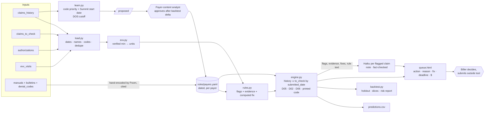

# Plan v4 (final): Resonance take-home, Exchange4Health claims pre-check

This is the plan Poom works from. It is self-contained. It supersedes every earlier plan and ideas file. In particular, **ideas-v3 §2 (its 5-beat demo script) and §3–§6 are superseded by this document**. Rehearse only §6 here.

Every number below was produced by code on the synthetic data pack (pandas). The pre-build scripts are in `profiling/` and `plan/scripts/` on the planning box; reference values are in Appendix A. They are for checking Poom's output after his own run. They never go into prompts as targets.

---

## 0. Provenance and how Poom uses this plan

**Before the build.** AI agents in planner, ideas and critic roles read the brief and profiled the data. Poom has read their output. So these findings are **known going in**:
- two date formats;
- payer-specific rounding;
- dated bulletins;
- auth drawdown across both claim files;
- payer-specific code priority;
- an undocumented Summit hourly rule.

**During the build.** Each finding is reproduced and checked in Poom's repo, by a script he asks Claude Code for, runs and reads. If his number differs from Appendix A, he investigates and logs why. Discovery credit goes only to what comes out of the build:
- bugs Claude Code introduced and how he caught them;
- the Haiku eval result;
- mismatches with Appendix A.

**Per step:**
1. Run the given prompt.
2. Read the code.
3. Run it.
4. Check the "Verify" items on real rows.
5. Write one line in `docs/ai_log.md`: what Claude did, what Poom changed, what went wrong.

**Standard wording** (README, demo, Q&A): "The pre-build analysis, done with AI agents and disclosed in the README, flagged X. I reproduced and checked it in my own run; my number was Y (ai_log entry N)."

**Defend without notes:**
1. Why drawdown runs over both files in submitted-date order.
2. How code priority is learned from the fit months, and which pairs are thin.
3. How the Summit rule's start date is learned, and how it does on later months.
4. Why D99 is never predicted.
5. Why rules are hand-encoded, and what Haiku adds over a template (§1.4).

---

## 1. Problem framing and scope

### 1.1 What the brief says (quoted)
- Case study §6: *"The idea. Build an AI assistant for agencies' billing teams. It would read each payer's rules, check a claim against them before submission, predict which claims will be denied, and suggest the fix."*
- Case study §7: *"Leadership has framed this as an assistant. You're free to be more ambitious if you think the case supports it."* The ask includes *"Design the system. Sketch the main components, what the AI does versus what's rules-based, what data and context it needs, and where a human stays in the loop."*
- Setup guide §1: *"If your app calls Claude once per claim, Haiku 5.5 is much cheaper for that; running thousands of claims through a large model will use up your credit quickly."*
- That last line is advice on model choice. It does not require per-claim calls, and it does not limit the app to them.

### 1.2 User and job
- **User:** an agency billing coordinator, the day before claims go out.
- **Question:** "Which of these claims will bounce, and what do I do about each one?"
- **Per claim, the tool gives:**
  - the verdict;
  - the one code the payer will print;
  - every rule the claim breaks;
  - the computed fix;
  - an action;
  - a plain-language note.

### 1.3 Scope choice: who reads the payer rules
The brief's idea has the assistant **read each payer's rules**. This plan deliberately does not do that at runtime. Poom reads the five payer documents and hand-encodes them as dated rules. Reasons:
- **Size.** The pack has five short documents (3,695 bytes in total). Hand-encoding them takes about 20 minutes and can be checked line by line.
- **Cost of error.** A misread effective date or rounding rule wrongly holds or passes money. Rules that are written down can be audited and tested against payer outcomes. A model's reading of the same text needs that same check anyway.
- **What the data rewards.** Every documented rule's flagged history claims were denied by the payer. The hard parts are state and order (drawdown across files, code priority), and those are computation, not reading.
- **Where model reading belongs.** At 180+ payers, a model should draft rules from bulletins into a `proposed/` folder, a human approves them, and a backtest gates them. That is the production design (§2.5, §8). It is listed as a stretch item but **not expected to be built** in the time.

So the AI in this build is small and deliberate. Rules **check, predict and compute the fix**. Haiku **writes the fix up for the biller**, once per flagged claim, using the model the setup guide advises for per-claim calls.

### 1.4 The honest answer to "what does Haiku add over the template?"
"In this pack I can show it's safe, not that it's better.
- The template is correct by construction, because it is built from the same engine facts I grade against.
- Haiku notes pass the same fact checks: my number from `note_eval.md`. They cost a measured amount per claim and read like a person wrote them.
- The value I'd expect is on multi-rule claims. The payer prints one code, and a biller who fixes only that code gets denied again. Haiku puts every issue and the order of fixes into one instruction.
- Whether billers act faster on that than on the template needs real users, so the pilot measures it.
- I kept Haiku in a place where it can't change a money decision. That is the safe way to introduce a model into billing."

If the eval fails the decision rule (§4.4), the queue shows the template and the README says so.

### 1.5 In scope
- Rules from the three payers' manuals and bulletins, dated by date of service (DOS).
- One chronological engine over history ∪ to_check: duplicates, auth drawdown, Harbor daily cap.
- Two things learned from fit months and approved by a human: code priority per payer, and the Summit hourly rule's start date.
- Backtest with a time holdout, billing KPIs, a to_check risk report and `predictions.csv`.
- `out/queue.html`: a static work queue with one card per claim.
- A Haiku note per flagged claim, with a measured eval.

### 1.6 Out of scope
- Opaque D99s (no feature explains them).
- Auto-submitting or auto-correcting claims.
- EVV app or scheduling integration.
- Payment amounts.
- A server UI.

### 1.7 What good looks like

| Outcome | Metric (all on the later-months holdout) |
|---|---|
| Don't hold claims that would pay | False holds: count and $ |
| Catch denials first | Denial recall and precision |
| Aim the fix | Status accuracy; exact status+code; code accuracy on multi-flag claims |
| Honest ceiling | D99 share printed next to each accuracy number |

Action classes are a deterministic mapping, so they are unit-tested, not scored. Pilot KPIs (§8): first-pass paid rate, days to cash, rework hours, live false-hold rate.

---

## 2. System design

### 2.1 Components
1. **`load.py` — normaliser.**
   - Explicit date formats only (`%Y-%m-%d`, `%m/%d/%Y`); fails on anything unparsed.
   - Maps payer spellings to PY01–PY03.
   - Strips and upper-cases service codes and modifiers.
   - Drops exact-duplicate export rows. These are not D05 duplicates.
2. **`rules/payers.yaml` — dated rules per payer.**
   - Covers rounding, filing limits, modifiers, daily cap, contract rules and code priority.
   - Each entry has `source`, `effective_from`/`to`, `date_basis: DOS`, and `status` (`documented` | `learned_confirmed` | `assumption`).
3. **`evv.py` — EVV matcher.**
   - Verified visits only, keyed by patient + service + clock-in date. Overnight visits count on the clock-in day.
   - Sums minutes, then converts them to units with the payer's rounding.
4. **`rules.py` — static checks:** D01, D03, D04, D07, D08, D09, D10.
   - Each returns **evidence**: minutes, allowed units, lag vs limit, deadline, auth window.
   - Each returns a **computed fix**:
     - D09: units → allowed units.
     - D04: the required modifier.
     - D07/D08: the auth on file covering the patient, service and DOS.
     - D10: the largest whole-hour count at or below allowed units. Labelled "untested: 0 such claims in history".
     - D03: the deadline date.
5. **`engine.py` — one pass over history ∪ to_check**, sorted by (submitted_date, claim_id).
   - State: duplicate keys (D05; frequency-7 claims exempt), auth balances (paid claims only), Harbor paid units per member per day (D06).
   - History rows update state with actual outcomes; to_check rows use predicted outcomes.
   - Records all flags. Picks the printed code by payer priority.
   - Also records: the claim each D05 duplicates; whether a D02 depended on earlier predicted-paid to_check claims; and for D07/D08 fixes, the replacement auth's remaining balance at that point.
6. **`learn.py --cutoff DATE`** writes to `proposed/`:
   - (a) code priority: pairwise "reported over" counts among denied multi-flag claims, per payer, with all counts kept;
   - (b) the Summit rule's start: the first DOS month where non-hourly PY03 claims carry the amendment remark and none are paid.
7. **`backtest.py`** — holdout, metrics, demo slices, risk report.
8. **`predict.py`** — writes `out/predictions.csv` and `out/queue.html`.
9. **`explain.py` + `note_eval.py`** — Haiku note per flagged claim, and its eval.

**Action classes** (unit-tested):

| Class | When |
|---|---|
| `SUBMIT` | No flags |
| `FIX_AND_SUBMIT` | D04, D07, D08, D09, D10 |
| `HOLD_EVV_PENDING` | D01 with a `manual_edit_pending` visit: wait, don't rework |
| `FIX_VISIT` | D01 with a `rejected` visit |
| `NO_VISIT_RECORD` | D01 with no EVV row |
| `DROP_DUPLICATE` | D05: names the earlier claim and which file it is in |
| `WRITE_OFF_OR_SUBMIT_BY` | D03, with the deadline |
| `AUTH_SHORTFALL` | D02 |
| `DAILY_CAP` | D06 |
| `MANUAL_REVIEW` | Overrides the class (status still predicted) when the printed code rests on a code-priority pair seen 0–1 times in history, or on an `assumption` rule |

**D07/D08 fix balance.** The card shows the replacement auth's remaining balance at the claim's position in the pass. If the claim's units exceed it, the card says the fix would hit D02. Effects on later claims are not checked; the card says so.

### 2.2 Rules vs AI

| Concern | Owner |
|---|---|
| Dates, rounding, EVV match, auth window, drawdown, daily cap, duplicates, deadlines | Rules |
| Computed fixes, replacement auth and its balance | Rules |
| Printed code | Rules (learned priority, human-approved) |
| `status`, `denial_code` | **Rules only.** The model never changes a prediction. |
| Plain-language note per flagged claim | **Haiku** |
| Reading payer documents into rules | Human in this build (§1.3). Model + human approval in production. |

### 2.3 The Haiku call

**Input** (one flagged claim):
- the normalised claim;
- every flag with its evidence;
- the printed code;
- the action class;
- the computed fixes;
- the verbatim rule text.

**Output** (JSON):

```json
{"summary": "...", "why_each_rule": [{"code": "D09", "plain": "..."}],
 "what_to_do": ["..."], "watch_out": "..."}
```

**Guardrails:**
- temperature 0; JSON schema; cached by input hash; `--limit`; `--dry-run` uses the template;
- model id from env `CLAUDE_MODEL` (Haiku tier);
- code-checked faithfulness and banned advice (longer visits, rescheduling, billing more).

### 2.4 Human in the loop
- **Biller:** works `queue.html` and decides. The tool never submits.
- **Payer-content analyst:** approves `proposed/` (code priority, Summit rule) after the backtest delta.
- **D99 and `MANUAL_REVIEW` claims:** a person decides.

### 2.5 Rule ownership and unannounced changes
- The **Exchange4Health payer-content team** owns one rule pack per payer. Agencies never edit YAML.
- Changes go `proposed/` → backtest delta → analyst approval → versioned release.
- **Drift monitor (production):** alert when a new remark × payer pattern reaches N denials (N = 5 is an ASSUMPTION). It proposes a candidate rule with support and precision. `learn.py` does this on fit months in the build.
- **Summit facts:**
  - The payer codes the same remark as D10 and as D99.
  - Payer-wide scope is an ASSUMPTION, consistent with AG008 stopping non-hourly billing from July but not proven by it.
  - C020368 (AG008, to_check) is tagged `assumption` → `MANUAL_REVIEW`.

### 2.6 Design sketch



Made in step C7b (Phase 1), so it exists at Checkpoint A.

---

## 3. Build plan

### 3.1 Budget (times set from scope)

| Step | What | Min |
|---|---|---|
| C0 | Repo, guardrails, CLAUDE.md | 10 |
| C1 | Load, profile, normalise, tests | 20 |
| C2 | EVV units + hand-written rounding tests | 15 |
| C3 | 7 documented checks from 5 docs, evidence, fixes, spot-check 1 claim per check | 20 |
| C4 | Chronological engine + tests | 30 |
| C5 | learn.py (priority + Summit date) and approval | 10 |
| C6 | Backtest: 2 configs × 2 periods, metrics, the two demo slices, predictions.csv | 25 |
| C6r | Risk report from data the engine already records, + 2 sensitivity reruns | 5 |
| C7 | queue.html | 10 |
| C7b | docs/design.md mermaid + PNG export | 5 |
| **Phase 1, App v1** | | **150** |
| C8 | explain.py (Haiku) | 15 |
| C9 | note_eval.py + grading 20 notes | 15 |
| **Phase 2** | | **30** |
| C10 | README (paste results from out/), one timed dry run of §6 | 15 |
| **Phase 3** | | **15** |
| **Core total** | 150 + 30 + 15 | **195** |
| **Contingency** | 10 before Checkpoint A + 35 after Checkpoint B | **45** |
| **Planned stretch** | | **0** |
| **Total** | 195 + 45 + 0 | **240** |

**Why C6 is 25 + 5, not 15.** The earlier 15-minute C6 asked for 4 configs, ablations and 5 risk analyses in one prompt. This version:
- cuts the holdout to 2 configs (priority learned on fit months; priority refit on all history);
- moves bulletin ablations to stretch;
- moves risk-report bookkeeping into the engine (C4) so C6r only prints it and runs 2 reruns.

25 + 5 = 30 min, against 35 for the full scope.

### 3.2 Clock and checkpoints

| Clock | What |
|---|---|
| 0:00–2:30 | Phase 1 (150 min) |
| **2:30 planned, 2:40 latest** | **Checkpoint A: App v1** (10 min contingency) |
| 2:40–3:10 | Phase 2 (30) |
| 3:10–3:25 | Phase 3 (15) |
| **3:25 latest** | **Checkpoint B: App v2** |
| 3:25–4:00 | Reserve, 35 min: recovery, then the final dry run |

Arithmetic: 150 + 10 = 160 (2:40) → + 30 + 15 = 205 (3:25) → + 35 = 240 (4:00). Contingency = 10 + 35 = 45.

**At 2:00 there is no demoable app.** C0–C5 are done and C6 is in progress. That is the honest consequence of timing C6 properly. The first demoable point is Checkpoint A.

**Checkpoint A, App v1.** Demoable: §6 minus beat 5.
- `out/profile.txt`
- dated rules
- engine
- learned priority and Summit date (approved)
- `out/backtest_report.md`: holdout, KPIs, demo slices, risk report
- `out/predictions.csv`
- `out/queue.html` with template notes and tags
- `docs/design.png`

**Checkpoint B, App v2.** Demoable: full §6.
- App v1
- Haiku notes in the queue cards
- `out/note_eval.md`
- README

**Stretch** runs only from unused reserve after Checkpoint B, and only if at least 20 min would remain afterwards for the dry run. Stretch output **never appears in the demo or README results**. The README mentions it only under "next steps". Order:
1. S1 `recheck` (10)
2. S2 bulletin ablations (10)
3. S3 model-drafted bulletin rule with gold diff and §9.5 refusal (30)
4. S4 Streamlit reskin (25)

### 3.3 Steps

**C0. Repo and guardrails (10)**
- *Prompt:* "Set up a Python repo here: venv, requirements.txt (pandas, pyyaml, anthropic, python-dotenv, pytest), .gitignore with .env, .venv/, out/cache/. Add .env.example with empty ANTHROPIC_API_KEY and CLAUDE_MODEL. Write CLAUDE.md: never read or print the key; rules compute predictions, the model never does; explicit date formats; every rule cites its source file."
- *Verify:* `.env` is not in `git status`; `git grep -i "sk-ant"` is empty. Commit.

**C1. Load and profile (20)**
- *Prompt:* "Write claimcheck/load.py. First print a profile to out/profile.txt: date patterns per column, payer name variants, service-code and modifier variants, exact duplicate rows. Then normalise with explicit formats and fail on anything unparsed. Add tests."
- *Verify:* any slash date with first field > 12? Payer variants, duplicate rows, 3 rows raw vs normalised. Compare with Appendix A; log differences.

**C2. EVV units (15)**
- *Prompt:* "Write evv.py: verified visits only, key patient+service+clock-in date, summed minutes, units by each payer's rounding rule from the manuals."
- *Verify:* write the tests by hand from the manual text: 127 min → 8 units for every payer; 128 → 9 for Northwind, 8 for Harbor and Summit; an overnight visit counts on its clock-in day.

**C3. Documented rules (20)**
- *Prompt:* "Write rules/payers.yaml and rules.py from the five payer documents only, dated by DOS. Each check returns evidence and a computed fix. Print per check: history claims flagged, and how many were denied."
- *Verify:* any check below ~100% flagged→denied is wrong; find out why. Spot-check one claim per check. Commit.

**C4. Engine (30)**
- *Prompt:* "Write engine.py: one pass over history and to_check sorted by submitted_date then claim_id. Track duplicates (frequency 1 only), auth balances (paid only), Harbor member-day paid units. History uses actual outcomes, to_check predicted. Record all flags; for each D05 the claim it duplicates; for each D02 whether earlier predicted-paid to_check claims caused it; for D07/D08 the replacement auth and its remaining balance. Add switches: replay history alone; reverse tie order; simulate history outcomes."
- *Verify:* run D02 with history alone and interleaved; compare how many history D02s each explains. Trace one auth claim by claim. The pre-build analysis says interleaving is needed; confirm or refute it on your output and log it.
- *Tests:* hand-made claims for duplicate, frequency-7 exemption, drawdown order, daily cap.

**C5. Learn (10)**
- *Prompt:* "Write learn.py --cutoff DATE: per payer, pairwise counts of which code was reported over which other flag among denied multi-flag claims; the order; all counts. Also the first DOS month where non-hourly PY03 claims carry the amendment remark and none are paid. Write both to proposed/."
- *Verify:* which pairs have ≥3 observations, which have 0–1? Is the Summit date data-derived? Approve into `payers.yaml`, recording who and when.

**C6. Backtest and predictions (25)**
- *Prompt:* "Write backtest.py. Config 1: priority and Summit date learned on DOS ≤ 2026-08-31, scored on fit (Jun–Aug) and score (Sep–Oct) periods. Config 2: priority refit on all history. Metrics per period: false holds (n, $), denial recall/precision, status, exact, multi-flag accuracy, D99 ceiling (1 − D99 share), per payer. Demo slices: (a) share of history denials with at least one documented-rule flag, and with the learned Summit rule added; (b) Summit non-hourly claims by DOS window (June / Jul–Aug / Sep–Oct): count, denied, paid, codes. Write out/backtest_report.md. Then predict.py → out/predictions.csv using config 2."
- *Verify:* holdout vs in-sample gap; misses by code; `predictions.csv` has 546 rows, `paid`/`denied` only, code blank iff paid, no D99.

**C6r. Risk report (5)**
- *Prompt:* "Append a to_check risk section to backtest_report.md: claims resting on thin priority pairs (0–1 observations), D02s depending on earlier predicted-paid to_check claims, D05s by source file, claims dated after the last history DOS, corrected claims, D07/D08 fixes whose replacement auth lacks balance, and how many predictions change with reversed tie order and with simulated history outcomes."
- *Verify:* read every count; open one thin-pair claim.

**C7. queue.html (10)**
- *Prompt:* "predict.py also writes out/queue.html, one static file. Summary line: flagged/total and $ at stake. Rows sorted by action group (fix now → hold → deadline missed → submit), then deadline, then $. Each row expands to a card: every flag with evidence, printed code, computed fix (with replacement-auth balance), source quote, template note, tags."
- *Verify:* open it. Check the cards for C019757, a `HOLD_EVV_PENDING` claim and C020368 against the engine output.

**C7b. Design sketch (5)**
- Put the §2.6 mermaid in `docs/design.md` and export `docs/design.png` from mermaid.live.

**Checkpoint A.**

**C8. explain.py (15)**
- *Prompt:* "Write explain.py: for each flagged to_check claim send claim, flags, evidence, computed fixes, action class and quoted rule text to the model in env CLAUDE_MODEL. JSON schema from the plan. Cache by input hash, --limit, --dry-run template. Log input/output tokens and latency per call. Put notes in queue.html cards, template as fallback."
- *Verify:* read 5 notes against evidence, including C019757 and one hold.

**C9. note_eval.py (15)**
- *Prompt:* "Write note_eval.py: on every note check schema, that every number in the text appears in the claim's evidence or fixes, every flag code mentioned, action consistent with class, no banned advice. Stratified sample of 20 (10 multi-flag, 5 hold/visit, 5 single) into a grading sheet with engine facts beside each Haiku note and its template note. Summarise calls, tokens, latency median and p95. Write out/note_eval.md."
- *Verify:* grade the 20 on 4 yes/no items (printed code; every rule; fix matches; action) for both versions. Apply the decision rule (§4.4).

**C10. README and dry run (15)**
- Fill the README (§5) from `out/` files. Run §6 once with a timer.

**Checkpoint B.**

### 3.4 If behind
- **Phase 1 past 2:40:** keep going on Phase 1. Cut C7 cards to plain rows if needed. Never cut C6, C6r or C7b. Phase 2 starts only after App v1 works.
- **App v1 after 3:00:** run C8 with `--limit 30`, C9 with a 10-note sample, then C10.
- **App v1 after 3:30:** skip Phase 2. Do C10 and demo App v1. Beat 5 is dropped.
- **Never cut:** C0–C7b, C10, key hygiene.

### 3.5 Repo layout (`C:\Users\Poom Chansilpa\Desktop\Coding\Resonance_AC\Resonance_AC`)

```
Resonance_AC/
  README.md  CLAUDE.md  requirements.txt  .gitignore  .env.example
  data/                     # synthetic pack, unchanged
  rules/payers.yaml
  proposed/
  claimcheck/  load.py evv.py rules.py engine.py learn.py backtest.py predict.py explain.py note_eval.py
  tests/       test_load.py test_evv.py test_rules.py test_engine.py test_actions.py
  out/         profile.txt backtest_report.md predictions.csv queue.html notes.jsonl note_eval.md cache/
  docs/        design.md design.png ai_log.md timelog.md
```

### 3.6 Windows commands

```powershell
py -m venv .venv
.\.venv\Scripts\Activate.ps1
pip install -r requirements.txt
$env:ANTHROPIC_API_KEY = "<paste key>"   # this session only; or a local .env (git-ignored)
$env:CLAUDE_MODEL = "<Haiku model id from Anthropic docs>"
pytest -q
python -m claimcheck.learn --cutoff 2026-08-31
python -m claimcheck.backtest
python -m claimcheck.predict              # out\predictions.csv, out\queue.html
python -m claimcheck.explain --limit 200  # --dry-run needs no key
python -m claimcheck.note_eval
start out\queue.html
```

**Secrets**
- The key lives only in `ANTHROPIC_API_KEY` (shell) or a local `.env` loaded by python-dotenv.
- `.env` is in `.gitignore` from the first commit; only `.env.example` is committed.
- No key in code, logs, `CLAUDE.md` or the exported session.
- `explain.py` exits with a clear message if the key is missing.

**Cost tracking**
- Sonnet by default in Claude Code; Opus at most once.
- Run `/cost` after each step and log it in `docs/timelog.md`.
- If spend passes $20 of the $40 before Checkpoint B, stop using Opus and shorten prompts.
- Haiku calls are capped and cached.

**Config shape (illustrative):**

```yaml
PY01:
  rounding: eight_minute
  filing_limit_days:
    - {days: 30, dos_to: 2026-07-31, source: "PY01 manual 6.1", status: documented}
    - {days: 45, dos_from: 2026-08-01, source: "PY01 bulletin 2026-07", status: documented}
  priority: {order: [...], learned_from: "DOS <= 2026-08-31", approved_by: Poom}
PY03:
  contract_rules:
    - {id: amendment_3_whole_hours, code: D10, check: units_multiple_of_4,
       dos_from: <learned by learn.py>, status: learned_confirmed, scope_assumption: payer_wide}
```

---

## 4. Evaluation

### 4.1 Time holdout (headline)
- **Fit:** DOS 2026-06-01 → 08-31. **Score:** DOS 2026-09-01 → 10-20.
- **Config 1 (honest headline):** code priority and the Summit start date learned on fit months only.
- **Config 2:** priority refit on all history. This is the in-sample reference and is used for `predictions.csv`.
- The D99 ceiling is printed beside every accuracy number.

**Summit rule on later months.** Status and code are reported separately: "Sep–Oct: N of N non-hourly Summit claims denied, M coded D10" (C6 slice b).

### 4.2 Metrics
- False holds (n, $); denial recall and precision; status; exact; multi-flag accuracy; per payer.
- Tests are not circular. Unit tests come from manual text and hand-made claims, and the data oracle is the payer's recorded outcome.

### 4.3 to_check risks (C6r)

| Risk | Handling |
|---|---|
| Auth balances cross files | Interleaved engine; count of D02s depending on predicted-paid to_check claims |
| Leakage through state | Rerun with simulated history outcomes; count changes |
| D99 ceiling | Never predicted; expected miss rate from holdout D99 share |
| Tie order | claim_id tie-break; reversed rerun; count changes |
| Thin priority pairs | Listed; `MANUAL_REVIEW` |
| Summit scope (C020368) | `assumption` tag; `MANUAL_REVIEW` |
| D07/D08 fix lacks balance | Listed; the card warns |
| Corrected claims (only in to_check) | Per `billing_basics.md`; listed as untested |
| DOS after the last history DOS | Counted |
| Duplicates inside to_check | D05 names the earlier claim and file |
| Submission order is the biller's choice | Stated assumption (file `submitted_date` = submission order) |

**README confidence statement:**
- Status is robust to priority choices; expect roughly the holdout status figure.
- Codes are fragile on multi-flag claims, especially the thin-pair list.
- The in-sample figure is a reference, not the expected score.

### 4.4 Haiku note eval (C9)
- **On all notes:** schema-valid %, faithfulness (every number traceable to evidence or fixes), every flag mentioned, action consistent, banned-advice hits.
- **20-note fact check:** Haiku vs template on the same sheet, 4 yes/no items.
- **Cost and latency:** tokens and wall time per call (median, p95). $ per claim uses Anthropic's published Haiku price on the day.
- **Decision rule:** show Haiku notes only if faithfulness ≥ 95% and the fix item is 20/20. Otherwise show the template, and the README says why.
- **Limit (stated):** this shows safety and cost, not superiority. See §1.4.

### 4.5 predictions.csv
- Header `claim_id,status,denial_code`; 546 rows in input order.
- `status` is `paid` or `denied`.
- `denial_code` is `D01`–`D10`, or empty when paid. One code at most. Never `D99`.

---

## 5. README contents
1. What it does (3 lines), the user, the action classes.
2. **Scope choice** (§1.3): rules are hand-encoded from five documents rather than read by a model at runtime, and why. Haiku writes the per-claim note.
3. Results from `out/backtest_report.md`:
   - holdout (2 configs × 2 periods) and KPIs;
   - D99 ceiling;
   - confidence statement;
   - Summit slice;
   - risk counts.
4. Note eval from `out/note_eval.md`.
5. Run instructions (PowerShell and bash), `--dry-run` first.
6. Key handling; `CLAUDE_MODEL`.
7. Design sketch, rules vs AI, human gates, rule owner.
8. Assumptions, one line each:
   - month-first slash dates;
   - submitted_date = submission order, ties by claim_id;
   - priority learned from fit months;
   - Summit payer-wide from the learned date (C020368 flagged);
   - D99 not predicted;
   - export duplicates dropped;
   - corrected claims per `billing_basics.md`;
   - D10 fix untested;
   - D07/D08 fix checks the replacement balance only at that claim.
9. **How I worked with AI.**
   - Disclosure: "Before the build, AI agents (planning, ideas and critique roles) analysed the brief and data and wrote the plan I followed. I reproduced and checked their findings with my own scripts in Claude Code. Where my numbers differed, I say so below."
   - Then `ai_log.md` highlights, models used, `CLAUDE.md`, session history.
10. Next steps (including model-drafted rules) and rollout (§8).
11. Time spent and Claude Code spend.

---

## 6. Demo script (one version; 9:00 of content, 1:00 slack)

Runs on Poom's laptop from his repo. Commands run live, with `out/` and the Haiku cache as fallback. No beat needs a live API call.

| Time | Beat | Shown and said | Every number comes from |
|---|---|---|---|
| 0:00–1:00 | **1. Problem and scope** | The coordinator's question. Scope choice: rules hand-encoded from 5 documents, Haiku writes the note, humans approve. Out: D99, auto-submit. "X% of history denials have at least one documented-rule flag; Y% with the learned Summit rule." | C6 slice (a) |
| 1:00–1:45 | **2. Design** | `docs/design.png`: engine over both files, learned-rule gate, two human gates, rule owner | C7b |
| 1:45–3:00 | **3. Proof** | Run `python -m claimcheck.backtest` live. Holdout exact on Sep–Oct vs the D99 ceiling; false holds (n, $); misses by code. "Summit, Sep–Oct: N of N non-hourly claims denied, M coded D10." | C6 metrics; C6 slice (b) |
| 3:00–5:15 | **4. The coordinator's queue** | `start out\queue.html`. Summary: flagged/total and $ at stake. **C019757**: printed D10, also breaks D09; verified minutes → allowed units under Summit floor; fix units → allowed, which clears both. A **HOLD_EVV_PENDING** card: "wait for the aggregator, don't rework". **C020368**: assumption tag, "ask, don't trust". | C7 (summary); C2/C3 evidence via C7 (card values); C5/C7 (tag) |
| 5:15–6:30 | **5. Haiku per claim, measured** | C019757's Haiku note next to its template. `out/note_eval.md`: faithfulness %, 20-note fact check for both versions, tokens, latency, $ per claim. §1.4 answer, in one breath. | C9 |
| 6:30–8:00 | **6. How I worked with AI** | Disclosure line. 2–3 real `ai_log.md` entries: a Claude Code mistake and how it was caught. "The pre-build analysis flagged the cross-file drawdown and the code priority; I reproduced them; my numbers were …" | ai_log (C0–C10); C4/C5 output |
| 8:00–9:00 | **7. Next and rollout** | Pilot, rule owner, drift monitor, model-drafted rules with approval at 180+ payers, upstream EVV holds. No numbers. | none |

- **Demo at Checkpoint A** (if Phase 2 never happened): drop beat 5. Its 75 s become slack. In beat 6, say the notes are template-only.
- **Drop on the day if short, in order:** the C020368 glance → the HOLD card → the third `ai_log` entry. Never drop beats 3 or 6.
- **Banned lines:** "schedule longer", "bill more". The C019757 fix lowers units to the verified time.
- **Rehearse to 9:00.**

---

## 7. Risks and mitigations

| Risk | Mitigation |
|---|---|
| Phase 1 overrun | Times set from scope; 10 min slack at A; 35 min reserve; cut rules §3.4 |
| Priority overfit | Learned on fit months; thin pairs → `MANUAL_REVIEW` |
| Learned rule wrong in scope | Human approval; assumption tag; never auto-activated |
| Haiku unfaithful | Number check; decision rule; template fallback |
| "AI only paraphrases" challenge | §1.3 scope choice and §1.4 answer, stated up front |
| Self-grading bias | Factual items with answers beside them; template baseline; limit stated |
| Provenance gap | One standard wording (§0) |
| Network on demo day | Cache, `--dry-run`, pre-built `out/` |
| Claude Code spend | `/cost` per step; $20 stop rule |
| Key leak | Env var only; `.env` ignored; `git grep` before push |
| Windows quirks | `pathlib`, `encoding="utf-8"`, `start` |

---

## 8. How this lands in an agency
1. **Shadow pilot, 4 weeks:** 2 agencies × 1 payer. The queue runs before submission and billers submit as usual. Compare with payer outcomes weekly.
2. **Gate:** live false-hold rate and recall near holdout levels. Billers rate Haiku notes vs template notes. This is the readability test the pack can't run.
3. **Assisted mode:** billers act on fix, hold and duplicate actions. Measure first-pass paid rate, days to cash and rework hours.
4. **Owners:**
   - Exchange4Health payer-content team: rule packs, drift alerts, approvals;
   - agency billing lead: queue;
   - Exchange4Health product: upstream EVV holds.
5. **Scale:** more payer packs, with model-drafted rules from bulletins going into `proposed/` with analyst approval and a backtest gate.

---

## Appendix A: Pre-build reference values (AI-agent analysis, disclosed; for cross-checking only)

**Data**
- History: 3,862 rows → 3,830 after dropping 32 exact duplicates; 2,731 paid / 1,099 denied.
- to_check: 546 rows (14 corrected).
- Slash dates are month-first. 9 payer spellings → 3 payers. 16 distinct remark strings.
- Payer documents: 5 files, 3,695 bytes.

**Denials explained (C6 slice a)**
- 1,009 of 1,099 denials (91.8%) have at least one documented-rule flag.
- 1,038 (94.5%) with the learned Summit rule added.
- Every documented rule's flagged history claims were denied, except 1 paid claim predicted D02.

**Holdout** (fit Jun–Aug, score Sep–Oct)
- Config 1, Sep–Oct: exact 97.97%, status 98.42%.
- Config 2, Sep–Oct: exact 98.20%.
- Ceiling 98.27% (23 D99 of 1,331).
- 1 false hold ($38); 20 missed denials, all opaque D99.

**Summit (C6 slice b)**

| DOS window | Non-hourly claims | Denied | Codes | Paid |
|---|---|---|---|---|
| June | 105 | 22 | other codes | 83 |
| Jul–Aug | 32 | 32 | 21 D10, 9 D99, 1 D01, 1 D07 | 0 |
| Sep–Oct | 20 | 20 | 14 D10, 3 D99, 2 D01, 1 D07 | 0 |

- First amendment DOS 2026-07-01.
- AG008: June 6 of 13 non-hourly; July onward 0 of 61.

**Bulletins** (stretch S2 ablations)
- Northwind: 49 history prediction changes (45 D03→paid, 3 D03→D05, 1 paid→D02: C007353); 47 match actuals. 17 to_check changes.
- Harbor: 36 history / 14 to_check changes.

**to_check**
- 377 paid / 169 denied; $17,787.30 of $54,064.80 flagged.
- 29 multi-flag claims; 11 rest on thin pairs.
- 4 of 13 D02s depend on earlier predicted-paid to_check claims.
- Tie reversal: 0 changes. Simulated history state: 1 change.
- D05: 20 duplicate history claims, 7 duplicate to_check claims.
- D01: 19 no EVV row, 5 rejected, 4 pending (C020752, C020748, C021249, C021017).
- 149 claims dated after 2026-10-20.

**Fixes**
- C019757: PY03 T1019, 34 units, one verified visit of 483 min (07:45–15:48 on 2026-09-03) → 32 units; flags D09 + D10; rechecked at 32 → paid, with 0 other to_check changes.
- All 93 D07 and 85 D08 claims across both files have a covering auth on file.
- Of the 14 to_check D07/D08 claims, 12 fit the replacement auth's remaining balance. 2 would hit D02: C021224 (30 units, 11 left) and C019478 (30 units, 2 left).

---

## Response to critique-v3

| # | Point | Verdict | Reason | Section |
|---|---|---|---|---|
| M1 | The AI defence misstated the brief by claiming it requires per-claim AI | **Fixed** | Phrase deleted. §1.1 quotes the brief exactly. §1.3 states hand-encoded rules as a deliberate choice against "read each payer's rules", with reasons. §1.4 gives the honest "what does Haiku add" answer: safe and measured, not shown to be better. | §1.1, §1.3, §1.4, §2.2 |
| M2 | Step times were subtracted, not scoped; C6 at 15 is fiction | **Fixed** | C1 20, C2 15, C3 20 restored. C6 re-timed to 25 + C6r 5, with scope cut (2 configs, ablations to stretch, risk bookkeeping in the engine). Core 195, contingency 45, planned stretch 0. Checkpoint A at 2:30 (latest 2:40), B at 3:25. Stated plainly that nothing is demoable at 2:00. Stretch is kept out of the demo and README results. | §3.1, §3.2, §3.4 |
| m1 | The 2:00 demo has no design artifact | **Fixed** | C7b (design.md + PNG, 5 min) is in Phase 1, so Checkpoint A has it | §3.1, §3.3 C7b |
| m2 | Two orphaned demo numbers | **Fixed** | Both are now explicit outputs of C6 (slice a: denial share; slice b: Summit by DOS window), inside its 25 min. Every demo number is mapped to a step in §6's last column. The "bill in DOS order" count is not shown. | §3.3 C6, §6 |
| m3 | D07/D08 lookup ignores balance | **Fixed** | Engine records the replacement auth's balance at that point. The card warns when it's short (2 to_check claims); later-claim effects are stated as unchecked. | §2.1, §4.3, App. A |
| m4 | ideas-v3 §2 is a second demo script | **Fixed** | Header states ideas-v3 §2–§6 are superseded; rehearse only §6 | Header |
| m5 | 10 minutes with zero slack | **Fixed** | Beats total 9:00 with 1:00 slack; rehearse to 9:00 | §6 |

**Count: 7 Fixed, 0 Rejected, 0 Deferred.**

**ideas-v3 items folded in:**
- C020368 assumption tag.
- Summit learned date and the "20 of 20 denied, 14 coded D10" wording.
- Action-class mapping unit-tested.
- Queue sort order and cards.
- `recheck` as stretch S1.
- Model-drafted bulletin rules as stretch S3 and production design.

**Not folded in:** its compiler-in-core and Haiku-to-stretch, for time and §1.3 reasons.
